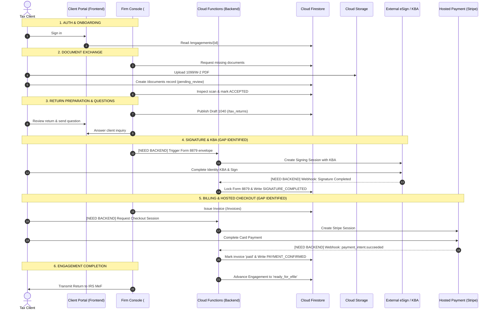

# End-to-End Workflow Architecture Review: The Complete Tax File Lifecycle

**Application:** The File Room / Pivot Aide Tax  
**Scope:** Complete Step-by-Step System Trace from Client Authentication to IRS Modernized e-File (MeF) Transmission  
**Governing Standards:** IRS Publication 1345, IRC § 7216, FTC Safeguards Rule (16 CFR Part 314), PCI-DSS Level 4 SAQ-A

---

## 1. Complete Step-by-Step Architecture Map

| Step # | Journey Milestone | 1. Frontend Screen / Element | 2. JavaScript Function(s) | 3. Firebase Service | 4. Firestore Collection | 5. Storage Location | 6. User Role | 7. Security Rule Governing Step | 8. Audit Event Generated | 9. External Provider |
| :--- | :--- | :--- | :--- | :--- | :--- | :--- | :--- | :--- | :--- | :--- |
| **1** | **Client Sign In** | Header Auth Modal / Passwordless Email-Link | `FirebaseBridge.signIn()`, `onAuthStateChanged()`, `updateAuthUI()` | Firebase Authentication | `/users/{uid}`, `/audit_logs` | *N/A* | Unauthenticated → `CLIENT` (`individual_filer`) | `request.auth != null`, user can read own profile | `AUTH_SESSION_STARTED` | Firebase Auth (Google / Email Link) |
| **2** | **Your File (Engagement)** | `#s-home` (Dashboard Overview) | `showScreen('home')`, `FirebaseBridge.getEngagement()`, `renderHomeScreen()` | Cloud Firestore | `/engagements/{engagementId}` | *N/A* | `CLIENT` | `resource.data.clientUid == request.auth.uid` or `isFirmStaff()` | `ENGAGEMENT_VIEWED` | *N/A* |
| **3** | **Document Request** | `#s-docs` (Checklist Grid) | `FirebaseBridge.getDocumentRequests()`, `renderDocChecklist()` | Cloud Firestore | `/documentRequests/{requestId}` | *N/A* | `PREPARER` creates; `CLIENT` reads | Read: `request.auth.uid == resource.data.clientId`. Write: `isFirmStaff()` | `DOCUMENT_REQUEST_ISSUED` | *N/A* |
| **4** | **Document Upload** | `#s-docs` (`#doc-upload-dropzone`, `#file-input`) | `handleFileUpload()`, `FirebaseBridge.uploadDocument()` | Cloud Storage & Firestore | `/documents/{docId}` | `clients/{userId}/tax-years/{taxYear}/documents/{docId}` | `CLIENT` | Storage: `isOwner(userId) && isValidTaxDocument()`. Firestore: `request.resource.data.clientId == request.auth.uid` | `DOCUMENT_UPLOADED` | *N/A* |
| **5** | **Preparer Review** | `#s-firm` (Firm Operations Triage) | `loadFirmScreen()`, `openFirmDocReviewModal()` | Cloud Firestore | `/documents/{docId}`, `/engagements/{id}` | *N/A* | `PREPARER` (`firm_preparer`) or `ADMIN` | `isFirmStaff()` (custom token claim) | `DOCUMENT_INSPECTED` | *N/A* |
| **6** | **Document Accepted** | `#s-firm` (Doc Review Modal Action) | `staffAcceptDocument(docId, notes)` | Cloud Firestore | `/documents/{docId}`, `/documentRequests/{id}`, `/audit_logs` | *N/A* | `PREPARER` / `ADMIN` | Staff only can mutate `status` to `accepted` or `rejected` | `DOCUMENT_ACCEPTED` | *N/A* |
| **7** | **Return Prepared** | `#s-firm` / Backend Tax Engine | `FirebaseBridge.saveTaxReturn()` (or Cloud Function) | Cloud Firestore & Storage | `/tax_returns/{returnId}`, `/engagements/{id}` | `clients/{userId}/returns/{returnId}.pdf` | `PREPARER` / `ADMIN` | Preparer write: `isFirmStaff()`. Client write blocked | `RETURN_PUBLISHED` | Tax Prep Software (Drake/UltraTax) |
| **8** | **Client Reviews Return** | `#s-return` (Summary & Form 1040 Breakdown) | `showScreen('return')`, `renderReturnDetails()`, `FirebaseBridge.getTaxReturn()` | Cloud Firestore & Storage | `/tax_returns/{returnId}`, `/audit_logs` | `clients/{userId}/returns/{returnId}.pdf` (signed URL) | `CLIENT` | `request.auth.uid == resource.data.clientUid` | `RETURN_VIEWED` | *N/A* |
| **9** | **Client Asks Question** | `#s-msgs` (Encrypted Messaging Thread) | `sendMessage()`, `FirebaseBridge.sendMessage()` | Cloud Firestore | `/messages/{msgId}` | *N/A* | `CLIENT` | Sender must be participant (`request.auth.uid == request.resource.data.uid`) | `MESSAGE_SENT` | Web Push / SendGrid notification |
| **10** | **Preparer Responds** | `#s-firm` / `#s-msgs` | `staffReplyMessage()`, `renderMessages()` | Cloud Firestore | `/messages/{msgId}` | *N/A* | `PREPARER` / `ADMIN` | `isFirmStaff()` | `MESSAGE_SENT` | Web Push / Twilio SMS |
| **11** | **Signature Request** | `#s-firm` (Escalation Chase / Send Envelope) | `initiateSignatureEnvelope()`, `FirebaseBridge.requestForm8879Signature()` | Cloud Functions & Firestore | `/engagements/{id}`, `/signatures/{sigId}` | *N/A* | `PREPARER` / Cloud Function | `isFirmStaff()` triggers Cloud Function | `SIGNATURE_ENVELOPE_CREATED` | External e-Sign Provider (DocuSign/PandaDoc) |
| **12** | **External Signing & KBA** | External Provider Redirect / Embedded Iframe (`#s-sign`) | `launchExternalSigningSession()` | External Provider Server | Provider Datastore | External Provider Vault | `CLIENT` + Spouse | External Provider Auth & NIST SP 800-63-3 Dynamic Credit Bureau KBA | External Provider Audit Log | External e-Sign / Experian / LexisNexis KBA |
| **13** | **Signature Completed** | Webhook Receiver Cloud Function | `onSignatureCompletedWebhook()` (Backend HTTP Endpoint) | Cloud Functions & Firestore | `/signatures/{sigId}`, `/engagements/{id}`, `/audit_logs` | `clients/{userId}/returns/form_8879_executed.pdf` | External Provider Webhook (System/Service Role) | Cloud Function Admin SDK (bypasses client security rules) | `SIGNATURE_COMPLETED`, `FORM_8879_LOCKED` | External Signing Provider Webhook |
| **14** | **Invoice Issued** | `#s-bill` (Invoices Screen) | `renderBillingScreen()`, `FirebaseBridge.getInvoices()` | Cloud Firestore | `/invoices/{invoiceId}` | *N/A* | `ADMIN` creates; `CLIENT` reads | Read: `request.auth.uid == resource.data.clientId`. Write: `isFirmStaff()` only | `INVOICE_ISSUED` | *N/A* |
| **15** | **Hosted Payment Session** | `#s-bill` (`#btn-pay-hosted`, `#btn-pay-invoice`) | `createCheckoutSession()` → Redirect to Stripe/Hosted Checkout | Cloud Functions & Stripe API | `/invoices/{invoiceId}` (status: `pending`) | *N/A* | `CLIENT` | Client invokes Cloud Function with `invoiceId`. No direct Firestore write to `paid` | `PAYMENT_SESSION_CREATED` | Stripe / Helcim Hosted Checkout |
| **16** | **Payment Webhook** | Backend Webhook Endpoint (`/api/stripe-webhook`) | `handlePaymentWebhook(req, res)` | Cloud Functions & Firestore | `/invoices/{invoiceId}`, `/engagements/{id}`, `/audit_logs` | *N/A* | Stripe/Payment Gateway Webhook Bot | Admin SDK verifying cryptographic HMAC (`Stripe-Signature`) | `PAYMENT_CONFIRMED` | Stripe Webhook / Payment Gateway |
| **17** | **Invoice Marked Paid** | Triggered by Webhook Handler | `updateInvoiceStatus(invoiceId, 'paid')` | Cloud Firestore | `/invoices/{invoiceId}` | *N/A* | Cloud Function (Admin SDK) | Blocked for client browser; write restricted to Admin SDK | `INVOICE_PAID` | Stripe / Payment Gateway |
| **18** | **File Completed / E-File Ready** | `#s-firm` / `#s-home` (Filing Complete Status) | `closeEngagement()` / `markReadyForEFile()` | Cloud Firestore | `/engagements/{engagementId}`, `/tax_returns/{id}` | *N/A* | `ADMIN` / `PREPARER` | `isFirmStaff()` | `ENGAGEMENT_COMPLETED`, `EFILE_TRANSMITTED` | IRS Modernized e-File (MeF) Gateway |

---

## 2. Broken Links, Missing Backend Logic & Architectural Gaps

Reviewing this complete lifecycle against the current repository reveals **7 specific architectural gaps** required to take the existing frontend into production:

### 1. Prototype Simulation vs. Real External Handshakes (Steps 11–13: Signatures & KBA)
- **Current State**: `#s-sign` contains an in-browser canvas and client-evaluated KBA quiz (`_evaluateKBA()`).
- **Missing Architecture**:
  - Missing Cloud Function: `/createSignatureSession` to generate Form 8879 PDF coordinates and invoke DocuSign/HelloSign/PandaDoc APIs.
  - Missing Cloud Function: `/api/signature-webhook` to receive completion payloads, download the executed 8879 certificate into Cloud Storage, and write `SIGNATURE_COMPLETED` via the Admin SDK.
  - **Regulatory Gap**: IRS Publication 1345 prohibits self-hosted, browser-evaluated KBA quizzes for Form 8879 e-signatures.

### 2. Client Payment Mutation vs. Webhook Verification (Steps 15–17: Hosted Billing)
- **Current State**: `#s-bill` renders invoice line items and simulates a payment session in JavaScript. `firestore.rules` correctly blocks client writes to `status: 'paid'`, but no live server-side session generator exists.
- **Missing Architecture**:
  - Missing Cloud Function: `createCheckoutSession({ invoiceId, clientId })` to return a `session.url`.
  - Missing Cloud Function: `handleStripeWebhook()` to verify HMAC signatures using `STRIPE_WEBHOOK_SECRET` before updating `/invoices/{invoiceId}` with `status: 'paid'` and `paidAt: serverTimestamp()`.
  - The client UI relies on local simulation when server endpoints are unconfigured.

### 3. Asymmetric Pipeline State Synchronization (Steps 6, 13, 17 → Step 18)
- **Current State**: When a preparer accepts all documents in `#s-firm`, or when an invoice is marked paid, the parent `/engagements/{engagementId}` status does not automatically update its pipeline stage (`intake_pending` → `in_prep` → `ready_for_review` → `signature_pending` → `efile_ready` → `completed`).
- **Missing Architecture**:
  - Needs a Firestore `onDocumentWritten` Cloud Function trigger to listen for state changes on sub-resources (`documents`, `tax_returns`, `signatures`, `invoices`) and automatically advance the parent engagement status.

### 4. Client Notification & Real-Time Webhook Back-Propagation (Steps 10, 13, 16)
- **Current State**: The client app primarily fetches data on navigation (`showScreen()`).
- **Missing Architecture**:
  - When an external event occurs (e.g. payment completes via Stripe webhook, or Form 8879 completes via DocuSign webhook), the client browser will not see the status change unless it re-renders or refreshes.
  - Real-time listeners (`onSnapshot`) are needed on the client's active invoice and signature records so the UI advances automatically without manual page reload.

### 5. Document Review: Missing Client-Facing Notification Loop (Step 6)
- **Current State**: When a preparer rejects a document with notes in `#s-firm` via `staffRejectDocument(docId, reason)`, the document status in `/documents/{docId}` changes to `rejected`.
- **Missing Architecture**:
  - The client does not receive an automated notification alerting them that a document was rejected and requires a re-upload.
  - Needs an `onUpdate` Cloud Function on `/documents/{docId}` that dispatches an automated notification into `/updates/{updateId}` and sends an email alert via SendGrid or Postmark.

### 6. Storage Security Claims vs. Custom Claims in Emulator (Steps 4 & 5)
- **Current State**: `storage.rules` enforces `isFirmStaff()` via `request.auth.token.role in ['firm_preparer', 'firm_admin']`.
- **Missing Architecture**:
  - When running locally in demo/dev mode without Firebase Admin minting custom claims, switching roles via `#btn-role-preparer` and `#btn-role-admin` toggles UI view logic, but does not mint genuine Firebase Auth custom claims tokens.
  - A local dev emulation script or Cloud Function endpoint (`/api/dev/set-custom-claims`) is needed for local development testing with real security rules.

### 7. WORM Audit Trail Backend Enclave (Steps 6, 8, 13, 16)
- **Current State**: The frontend writes certain audit logs (`FirebaseBridge.logAuditEvent()`) directly to `/audit_logs`.
- **Missing Architecture**:
  - While client-side logs provide helpful UI telemetry, regulatory compliance (FTC Safeguards, IRS Pub 1345) requires that security-sensitive actions (`DOCUMENT_ACCEPTED`, `SIGNATURE_COMPLETED`, `PAYMENT_CONFIRMED`) be emitted exclusively from trusted backend environments (Cloud Functions) using the Firebase Admin SDK.
  - Direct client writes to `/audit_logs` for these critical actions must be fully deprecated in favor of server-side emission.

---

## 3. End-to-End Sequence Diagram

